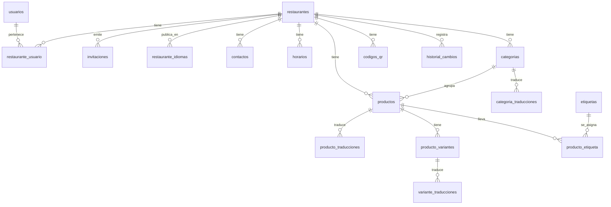
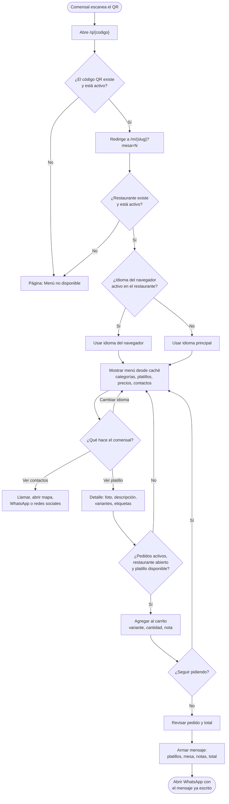
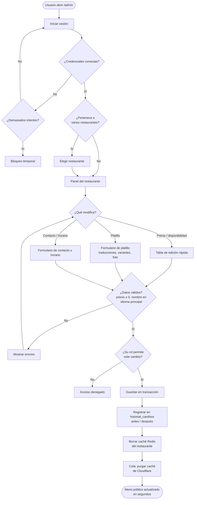
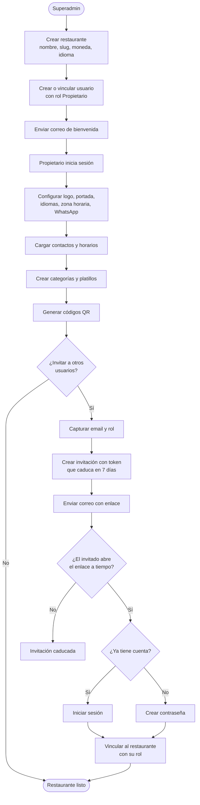
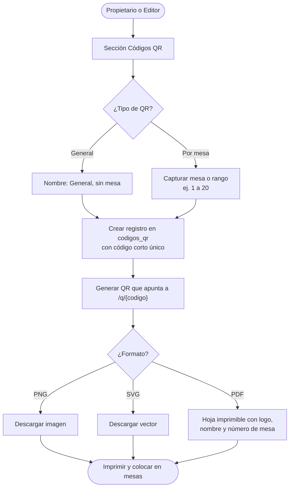

# MENUONL — Especificación del sistema

Menú digital con QR para restaurantes (multi-restaurante).
Versión 1.0 · 15 de octubre de 2026

## 1. Visión general

MENUONL es una plataforma en la que **varios restaurantes** publican su menú. El comensal lo abre al **escanear un código QR**, sin instalar nada. Cada restaurante administra desde un panel web sus **platillos, precios, fotos, contactos y horarios**, y los cambios se ven en el menú público al instante.

### 1.1 Actores

| Actor | Descripción |
| --- | --- |
| **Comensal** | Escanea el QR, consulta el menú y, si el restaurante lo permite, envía su pedido por WhatsApp. No necesita cuenta. |
| **Propietario** | Dueño o encargado. Acceso total a su restaurante: menú, precios, contactos, configuración y usuarios. |
| **Editor** | Personal del restaurante. Modifica menú, precios, contactos y horarios, pero no gestiona usuarios ni configuración general. |
| **Superadmin** | Operador de la plataforma. Da de alta, suspende y reactiva restaurantes. |

### 1.2 URLs principales

| Uso | URL |
| --- | --- |
| Menú público | `https://{dominio}/m/{slug}` |
| Menú desde el QR de una mesa | `https://{dominio}/m/{slug}?mesa=5` |
| Panel de administración | `https://{dominio}/admin` |

## 2. Requisitos funcionales

### 2.1 Menú público (comensal)

| ID | Requisito |
| --- | --- |
| RF-01 | Abrir el menú al escanear el QR, sin instalar nada ni registrarse. |
| RF-02 | Ver categorías y platillos en el orden definido por el restaurante, con nombre, descripción, precio, precio de oferta, foto y etiquetas (vegano, picante, sin gluten, etc.). |
| RF-03 | Ver las variantes de un platillo, cada una con su propio precio (chico / mediano / grande). |
| RF-04 | Los platillos agotados se muestran marcados como "Agotado" o se ocultan, según la configuración del restaurante. |
| RF-05 | Cambiar el idioma del menú. Por defecto se usa el idioma del navegador si el restaurante lo tiene activo; si no, el idioma principal del restaurante. |
| RF-06 | Ver contactos: teléfono (enlace para llamar), WhatsApp, dirección (enlace a mapa), redes sociales, horario y si está **abierto o cerrado** en ese momento. |
| RF-07 | Armar un pedido en el navegador (carrito) y enviarlo por WhatsApp con un mensaje ya escrito: platillos, variantes, cantidades, notas, número de mesa y total. Solo si el restaurante lo activa. |

### 2.2 Panel de administración

| ID | Requisito |
| --- | --- |
| RF-10 | Iniciar sesión con email y contraseña, y recuperar la contraseña por email. |
| RF-11 | Un usuario puede pertenecer a varios restaurantes y elegir cuál administrar. |
| RF-12 | Roles por restaurante: **Propietario** (todo, incluidos usuarios y configuración) y **Editor** (menú, precios, contactos y horarios). |
| RF-13 | El propietario invita usuarios por email indicando su rol, y puede revocar su acceso. |
| RF-14 | Crear, editar, eliminar y reordenar (arrastrando) categorías y platillos. |
| RF-15 | Editar precios rápidamente en una tabla y marcar un platillo como disponible o agotado con un clic. |
| RF-16 | Subir fotos de platillos, logo y portada. El sistema las convierte a WebP y las redimensiona automáticamente. |
| RF-17 | Capturar traducciones de nombres y descripciones en cada idioma activo del restaurante. |
| RF-18 | Crear, editar, eliminar y ordenar contactos y horarios de atención. |
| RF-19 | Configurar el restaurante: nombre, logo, portada, moneda, idioma principal, idiomas activos, zona horaria, número de WhatsApp para pedidos, activar o desactivar pedidos y mostrar u ocultar agotados. |
| RF-20 | Generar y descargar códigos QR (PNG, SVG o PDF imprimible), uno general o uno por mesa. |
| RF-21 | Consultar el historial de cambios: quién cambió qué, cuándo, y el valor anterior y el nuevo. |
| RF-22 | Los cambios guardados se reflejan en el menú público en segundos. |

### 2.3 Superadmin

| ID | Requisito |
| --- | --- |
| RF-30 | Dar de alta, suspender y reactivar restaurantes. Un restaurante suspendido muestra la página "Menú no disponible". |
| RF-31 | Consultar el listado de restaurantes y de usuarios de la plataforma. |

## 3. Requisitos no funcionales

| ID | Requisito |
| --- | --- |
| RNF-01 | **Rendimiento:** menú público pensado para celular; carga completa en menos de 1.5 s con 4G desde Latinoamérica. Páginas generadas en el servidor (sin aplicación JavaScript pesada). |
| RNF-02 | **Caché:** el menú se guarda en caché en dos niveles (Redis en el VPS y la red de Cloudflare). Ambos se borran al guardar un cambio en ese restaurante. |
| RNF-03 | **Aislamiento:** todas las consultas del panel filtran por `restaurante_id`. Un usuario nunca puede ver ni modificar datos de un restaurante al que no pertenece. |
| RNF-04 | **Seguridad:** HTTPS obligatorio, contraseñas con bcrypt o argon2, protección CSRF, límite de intentos de inicio de sesión y tokens de invitación con caducidad. |
| RNF-05 | **Base de datos:** MariaDB 10.6+, InnoDB, utf8mb4. Precios en `DECIMAL(10,2)`, nunca en `FLOAT`. |
| RNF-06 | **Respaldos:** copia diaria de la base de datos y de las imágenes, 14 días de retención, guardada fuera del VPS. |
| RNF-07 | **Borrado lógico:** restaurantes, categorías y platillos se marcan con `deleted_at` en lugar de borrarse. |
| RNF-08 | **Accesibilidad:** contraste AA, texto legible en celular y botones táctiles de al menos 44 px. |
| RNF-09 | **Disponibilidad:** si el VPS cae, Cloudflare sigue sirviendo la última versión del menú guardada en caché. |

## 4. Arquitectura

### 4.1 Latencia: VPS en Finlandia

El VPS está en **Finlandia** y los comensales, probablemente, en **Latinoamérica**. Cada ida y vuelta tarda unos **150–250 ms**, y abrir una página nueva requiere 3 o 4 viajes (DNS, TCP, TLS y la petición HTTP). Solo en red se pierden de 0.6 a 1 segundo. El lenguaje del servidor cambia entre 5 y 50 ms, así que **lo que más pesa es la distancia, no el lenguaje**.

**Solución:** poner **Cloudflare (plan gratuito) delante del VPS**.

- El HTML del menú público (`/m/*`) y las imágenes se guardan en los servidores de Cloudflare más cercanos al comensal (México, Bogotá, São Paulo, etc.). La carga baja a unos **30–80 ms**.
- Al guardar un cambio en el panel, la aplicación **borra la caché de ese restaurante** con la API de Cloudflare, y el precio nuevo se ve en segundos.
- El panel (`/admin`) no se guarda en caché y se conecta directo al VPS. Lo usan pocas personas, así que los ~200 ms extra son aceptables.

### 4.2 Componentes

| Componente | Función |
| --- | --- |
| **Cloudflare** | DNS, HTTPS, caché del menú público y de las imágenes en servidores cercanos al comensal. |
| **Nginx** | Servidor web en el VPS. Atiende HTTPS de origen y entrega imágenes con caché larga. |
| **Laravel 11 (PHP-FPM + OPcache)** | Aplicación. Menú público con Blade + Tailwind CSS; panel con Filament 3. |
| **MariaDB** | Base de datos principal. |
| **Redis** | Caché del menú ya armado y sesiones del panel. |
| **Supervisor + cola** | Tareas en segundo plano: procesar imágenes, enviar correos y borrar la caché de Cloudflare. |
| **Cron** | Respaldo diario de la base de datos y de las imágenes. |

El menú público se entrega en **una sola petición HTML**, con un CSS pequeño y las imágenes con *lazy loading*, para hacer el menor número posible de viajes por la red.

## 5. Modelo de datos

MariaDB 10.6+, InnoDB, cotejamiento `utf8mb4_unicode_ci`. El script DDL completo con las 14 tablas, índices, claves foráneas y datos iniciales de etiquetas se encuentra en [docs/esquema.sql](esquema.sql).

### 5.1 Diagrama entidad–relación

Derivado del diccionario de datos (resumen de relaciones):

### 5.2 Diccionario de datos

#### usuarios

Personas que entran al panel.

| Campo | Tipo | Notas |
| --- | --- | --- |
| id | BIGINT UNSIGNED PK | Autoincremental |
| nombre | VARCHAR(120) | |
| email | VARCHAR(190) | Único |
| password_hash | VARCHAR(255) | bcrypt / argon2 |
| es_superadmin | TINYINT(1) | 1 = operador de la plataforma |
| activo | TINYINT(1) | 0 = no puede iniciar sesión |
| ultimo_acceso | DATETIME NULL | |
| created_at / updated_at | DATETIME | |

#### restaurantes

| Campo | Tipo | Notas |
| --- | --- | --- |
| id | BIGINT UNSIGNED PK | |
| nombre | VARCHAR(150) | |
| slug | VARCHAR(80) | Único; se usa en `/m/{slug}` |
| descripcion | VARCHAR(500) NULL | Texto corto bajo el logo |
| logo / portada | VARCHAR(255) NULL | Ruta de la imagen |
| moneda | CHAR(3) | ISO 4217 (MXN, COP, USD…) |
| idioma_default | VARCHAR(5) | ej. es, en |
| zona_horaria | VARCHAR(50) | ej. America/Mexico_City; para calcular abierto/cerrado |
| whatsapp_pedidos | VARCHAR(20) NULL | Formato internacional, solo dígitos |
| pedidos_activos | TINYINT(1) | Activa el carrito con envío por WhatsApp |
| mostrar_agotados | TINYINT(1) | 1 = marcados; 0 = ocultos |
| estado | ENUM('activo','suspendido') | |
| created_at / updated_at / deleted_at | DATETIME | Borrado lógico |

#### restaurante_usuario

| Campo | Tipo | Notas |
| --- | --- | --- |
| restaurante_id | BIGINT UNSIGNED PK, FK | |
| usuario_id | BIGINT UNSIGNED PK, FK | |
| rol | ENUM('propietario','editor') | |
| created_at | DATETIME | |

#### invitaciones

| Campo | Tipo | Notas |
| --- | --- | --- |
| id | BIGINT UNSIGNED PK | |
| restaurante_id | FK | |
| email | VARCHAR(190) | |
| rol | ENUM('propietario','editor') | |
| token | CHAR(64) | Único, aleatorio |
| invitado_por | FK → usuarios NULL | |
| expira_en | DATETIME | 7 días por defecto |
| aceptada_en | DATETIME NULL | |

#### restaurante_idiomas

| Campo | Tipo | Notas |
| --- | --- | --- |
| restaurante_id | PK, FK | |
| idioma | VARCHAR(5) PK | ej. es, en, pt-BR |
| orden | SMALLINT | Orden en el selector |

#### contactos

| Campo | Tipo | Notas |
| --- | --- | --- |
| id | BIGINT UNSIGNED PK | |
| restaurante_id | FK | |
| tipo | ENUM('telefono','whatsapp','email','direccion','instagram','facebook','tiktok','web','otro') | Define icono y tipo de enlace |
| etiqueta | VARCHAR(80) NULL | ej. "Reservaciones" |
| valor | VARCHAR(255) | Número, correo, dirección o URL |
| orden | INT | |
| visible | TINYINT(1) | |

#### horarios

| Campo | Tipo | Notas |
| --- | --- | --- |
| id | BIGINT UNSIGNED PK | |
| restaurante_id | FK | |
| dia_semana | TINYINT | 0 = domingo … 6 = sábado |
| abre / cierra | TIME NULL | Si cierra < abre, cierra al día siguiente |
| cerrado | TINYINT(1) | 1 = no abre ese día |

Se permiten varias filas por día (turno de comida y de cena).

#### categorias y categoria_traducciones

| Campo | Tipo | Notas |
| --- | --- | --- |
| categorias.id | BIGINT UNSIGNED PK | |
| categorias.restaurante_id | FK | |
| categorias.orden | INT | |
| categorias.visible | TINYINT(1) | |
| categorias.created_at / updated_at / deleted_at | DATETIME | |
| categoria_traducciones.categoria_id | PK, FK | |
| categoria_traducciones.idioma | VARCHAR(5) PK | |
| categoria_traducciones.nombre | VARCHAR(120) | ej. "Entradas" |
| categoria_traducciones.descripcion | TEXT NULL | |

#### productos y producto_traducciones

| Campo | Tipo | Notas |
| --- | --- | --- |
| productos.id | BIGINT UNSIGNED PK | |
| productos.restaurante_id | FK | Duplicado a propósito para filtrar rápido y reforzar el aislamiento |
| productos.categoria_id | FK | |
| productos.precio | DECIMAL(10,2) | ≥ 0 |
| productos.precio_oferta | DECIMAL(10,2) NULL | Si existe, se muestra tachando el normal |
| productos.imagen | VARCHAR(255) NULL | |
| productos.disponible | TINYINT(1) | 0 = agotado |
| productos.visible | TINYINT(1) | 0 = oculto del menú |
| productos.destacado | TINYINT(1) | Aparece en "Recomendados" |
| productos.orden | INT | |
| productos.created_at / updated_at / deleted_at | DATETIME | |
| producto_traducciones.producto_id | PK, FK | |
| producto_traducciones.idioma | VARCHAR(5) PK | |
| producto_traducciones.nombre | VARCHAR(150) | |
| producto_traducciones.descripcion | TEXT NULL | |

#### producto_variantes y variante_traducciones

| Campo | Tipo | Notas |
| --- | --- | --- |
| producto_variantes.id | BIGINT UNSIGNED PK | |
| producto_variantes.producto_id | FK | |
| producto_variantes.precio | DECIMAL(10,2) | Precio final de la variante |
| producto_variantes.disponible | TINYINT(1) | |
| producto_variantes.orden | INT | |
| variante_traducciones.variante_id | PK, FK | |
| variante_traducciones.idioma | VARCHAR(5) PK | |
| variante_traducciones.nombre | VARCHAR(80) | ej. "Grande" |

Si un platillo tiene variantes, el menú muestra el precio de cada una en lugar del precio base.

#### etiquetas y producto_etiqueta

Catálogo global (lo administra el superadmin). El nombre visible se traduce en los archivos de idioma de la aplicación según su `codigo`.

| Campo | Tipo | Notas |
| --- | --- | --- |
| etiquetas.id | BIGINT UNSIGNED PK | |
| etiquetas.codigo | VARCHAR(40) | Único, ej. `sin_gluten` |
| etiquetas.icono | VARCHAR(40) | Nombre del icono |
| producto_etiqueta.producto_id | PK, FK | |
| producto_etiqueta.etiqueta_id | PK, FK | |

#### codigos_qr

| Campo | Tipo | Notas |
| --- | --- | --- |
| id | BIGINT UNSIGNED PK | |
| restaurante_id | FK | |
| nombre | VARCHAR(80) | ej. "General", "Mesa 5", "Terraza" |
| mesa | VARCHAR(20) NULL | Se agrega a la URL y aparece en el pedido de WhatsApp |
| codigo | VARCHAR(16) | Único; URL corta `/q/{codigo}` que redirige al menú |
| activo | TINYINT(1) | |
| created_at / updated_at | DATETIME | |

El QR apunta a `/q/{codigo}`. Así, si el restaurante cambia su `slug`, los QR ya impresos siguen funcionando.

#### historial_cambios

| Campo | Tipo | Notas |
| --- | --- | --- |
| id | BIGINT UNSIGNED PK | |
| restaurante_id | FK | |
| usuario_id | FK NULL | NULL si lo hizo el sistema |
| entidad | VARCHAR(50) | ej. producto, contacto |
| entidad_id | BIGINT UNSIGNED | |
| accion | ENUM('crear','actualizar','eliminar') | |
| cambios | JSON | `{"precio": {"antes": "85.00", "despues": "95.00"}}` |
| created_at | DATETIME | |

### 5.3 Decisiones de diseño

- **Traducciones en tablas aparte** (`*_traducciones`): se agregan idiomas sin cambiar la estructura. Si falta una traducción, se muestra la del idioma principal.
- **`restaurante_id` también en `productos`**: consultas más rápidas y filtrado siempre por restaurante.
- **Índices:** `(restaurante_id, orden)` en categorías y productos; únicos en `slug`, `email`, `token` y `codigos_qr.codigo`.
- **Claves foráneas** con `ON DELETE CASCADE` en traducciones, variantes y tablas intermedias.
- **El pedido por WhatsApp no se guarda** en la v1: el carrito vive en el navegador y se envía con `https://wa.me/{numero}?text=...`.

## 6. Diagramas de flujo

### 6.1 Comensal: consultar el menú y pedir por WhatsApp

### 6.2 Propietario / Editor: modificar precio, platillo o contacto

### 6.3 Alta de restaurante e invitación de usuarios

### 6.4 Generación de códigos QR

## 7. Alcance de la versión 1

### Incluido

- Menú público multi-idioma con categorías, platillos, variantes, etiquetas, fotos y ofertas.
- Contactos, horarios y estado abierto/cerrado.
- Pedido por WhatsApp (sin pagos y sin guardar el pedido).
- Panel multi-restaurante con roles Propietario y Editor, invitaciones e historial de cambios.
- Generación de QR general y por mesa.
- Panel de superadmin para alta y suspensión de restaurantes.
- Cloudflare como CDN delante del VPS.

### Fuera de alcance (versiones futuras)

- Pagos en línea.
- Pedidos guardados en el sistema y pantalla de cocina.
- Estadísticas de escaneos y de platillos más vistos.
- Varias sucursales por restaurante.
- Dominio propio por restaurante.
- Planes, cobro y facturación de la plataforma.

## 8. Pendientes por confirmar

Ver [05-pendientes.md](05-pendientes.md).
